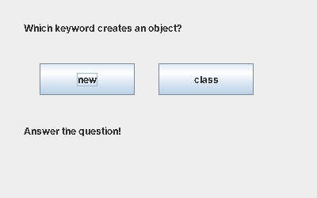
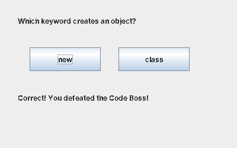
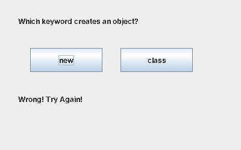

# Object-Oriented Programming Fundamentals in Java

### Assignment 1 (Individual, 20%): Tutorial Portfolio Repository


This repository collects all of my lab tutorial work (Weeks 1–10) for the Object-Oriented Programming course in one place. It shows how my Java skills progressed, starting with a "Hello, World!" program and finishing with an event-driven GUI quiz game.

---

## 📋 Student & Course Information

| Item | Details |
|---|---|
| **Student Name** | Ruder Sharma |
| **Student ID** | 202501010273 |
| **Programme** | Diploma in Information Technology (DIT) |
| **Class Code** | `<YOUR CLASS CODE>` |
| **Course** | DIT1113 / BIT1123 / BISE2093, Object Oriented Programming |
| **Lecturer** | Sir Nazmirul Izzad bin Nassir |
| **Faculty** | Faculty of Information Technology, City University Malaysia (Cyberjaya Campus) |
| **Session** | 202609 |
| **Repository** | https://github.com/ruderasharma321-ctrl/RUDER-SHARMA_object-oriented-programming-tutorials |

---

## 📖 Brief Course Description

Object Oriented Programming introduces the **object-oriented paradigm** using the **Java** programming language. The course moves from basic Java syntax to the four pillars of OOP: **encapsulation, inheritance, polymorphism and abstraction**. It then covers collections (`ArrayList`), file input/output, exception handling and graphical user interfaces with **Java Swing**. Industry practices such as version control with **Git and GitHub**, cloud development with **GitHub Codespaces**, and project documentation are used throughout the semester.

---

## 🗂️ Repository Structure

All folders follow one naming style, `tutorial_n`, matching the official list of 7 tutorials. Tutorial 1 covers two lab weeks, so it has a `week_1` and a `week_2` subfolder.

```
RUDER-SHARMA_object-oriented-programming-tutorials/
│
├── README.md                 # Project documentation (this file)
├── myreport.pdf              # Self-reflective report
├── LICENSE                   # MIT License
├── .gitignore                # Java .gitignore (ignores *.class etc.)
│
├── tutorial_1/               # Week 1 & 2
│   ├── week_1/               #   Getting Started (Codespaces, first programs)
│   │   ├── HelloWorld.java
│   │   ├── StudentGrade.java
│   │   └── output.txt
│   └── week_2/               #   Classes, Objects & Constructors
│       ├── Main.java
│       ├── Student.java
│       └── output.txt
├── tutorial_2/               # Week 3–4 – Inheritance & Method Overriding
│   ├── Main.java
│   ├── Person.java
│   ├── Student.java
│   ├── Lecturer.java
│   └── output.txt
├── tutorial_3/               # Week 5   – Encapsulation (Student Information System)
│   ├── Main.java
│   ├── Student.java
│   ├── documentation.txt
│   └── output.txt
├── tutorial_4/               # Week 6   – Inheritance with super & protected (Employee/Lecturer)
│   ├── Main.java
│   ├── Employee.java
│   ├── Lecturer.java
│   └── output.txt
├── tutorial_5/               # Week 7   – Abstraction (Smart Home Appliance System)
│   ├── Main.java
│   ├── Appliances.java
│   └── output.txt
├── tutorial_6/               # Week 8–9 – ArrayList & File I/O (To-Do List)
│   ├── Main.java
│   ├── task.txt
│   └── output.txt
└── tutorial_7/               # Week 10  – Java Swing GUI (Programming Quiz Battle)
    ├── Questions.java
    ├── QuizBattleGUI.java
    └── screenshots/
        ├── quiz_start.png
        ├── quiz_correct.png
        └── quiz_wrong.png
```

Each `output.txt` holds the real console output from running that tutorial, so the results can be checked without compiling the code.

---

## 📚 Tutorial Summary (Week 1–10)

| Folder | Week | Topic | OOP Concept | Key Files |
|---|---|---|---|---|
| `tutorial_1/week_1` | 1 | Getting Started with Codespaces via GitHub | Java program structure, `main`, `Scanner`, `if-else` | `HelloWorld.java`, `StudentGrade.java` |
| `tutorial_1/week_2` | 2 | Coding in Java | Classes, objects, attributes, constructors, methods | `Main.java`, `Student.java` |
| `tutorial_2` | 3–4 | University People | Inheritance, `extends`, `super`, `@Override`, polymorphism | `Person.java`, `Student.java`, `Lecturer.java` |
| `tutorial_3` | 5 | Student Information System | Encapsulation, `private`, getters & setters | `Student.java`, `documentation.txt` |
| `tutorial_4` | 6 | Employee and Lecturer | Inheritance, `protected`, `super(...)` constructor chaining | `Employee.java`, `Lecturer.java` |
| `tutorial_5` | 7 | Smart Home Appliance Management | Abstraction, `abstract` class & method | `Appliances.java` |
| `tutorial_6` | 8–9 | Personal To-Do List App | `ArrayList`, file I/O, try-with-resources, exceptions | `Main.java`, `task.txt` |
| `tutorial_7` | 10 | Programming Quiz Battle | GUI with Swing, `JFrame`, `ActionListener`, events | `Questions.java`, `QuizBattleGUI.java` |

### Week 1: Getting Started (`tutorial_1/week_1`)
I set up the GitHub repository (README, Java `.gitignore`, MIT License) and worked in GitHub Codespaces. `HelloWorld.java` is the first Java program. `StudentGrade.java` reads a student's name and marks with `Scanner` and uses an `if–else if` chain to give a grade from A to F.

### Week 2: Classes & Objects (`tutorial_1/week_2`)
A `Student` class with the attributes `name`, `age` and `gpa`, a constructor that stores the values, and the methods `displayInfo()`, `study()` and `takeExam()`. `Main` creates a `Student` object and calls its methods.

### Week 3–4: Inheritance & Polymorphism (`tutorial_2`)
`Person` holds the shared `name` and `id`. `Student` and `Lecturer` **extend** `Person` and **override** `introduce()`. All three objects are stored in `Person` references, so Java chooses the correct `introduce()` at runtime:
```
I am a person.
I am a student.
I am a lecturer.
```

### Week 5: Encapsulation (`tutorial_3`)
A secure `Student` class whose fields are all `private` and can only be reached through **setters and getters**. I added an extra `programme` variable as required. `documentation.txt` answers the three theory questions: why fields are private, what happens if they are public, and why we use getters and setters.

### Week 6: Employee and Lecturer (`tutorial_4`)
`Employee` uses `protected` fields so subclasses can access them. `Lecturer extends Employee`, passes `id` and `name` to the parent with `super(id, name)`, and adds `subject` and the required extra `department` variable.

### Week 7: Abstraction (`tutorial_5`)
An `abstract class Appliance` gives every appliance the same interface (`turnOn()`, `turnOff()`, `displayBrand()`) and declares `abstract void operate()`. The concrete classes `WashingMachine` and `Refrigerator` come from the template. I added two more appliances, `AirConditioner` and `Television`. Each one hides its own implementation behind the shared interface.

### Week 8–9: To-Do List with File I/O (`tutorial_6`)
The user enters three tasks, which are stored in an `ArrayList<String>` and displayed. The program then **saves** them to `task.txt` with `BufferedWriter`, **reads** them back with `BufferedReader`, and prints the loaded tasks. Both streams use try-with-resources, and `IOException` is handled.

### Week 10: Programming Quiz Battle GUI (`tutorial_7`)
`Questions` encapsulates one quiz question, its two options and the correct answer, with an `isCorrect()` check. `QuizBattleGUI extends JFrame implements ActionListener` builds the window with `JLabel` and `JButton`, and responds to clicks in `actionPerformed()`.

| Start | Correct answer | Wrong answer |
|---|---|---|
|  |  |  |

---

## 🛠️ Technologies Used

| Technology | Purpose |
|---|---|
| **Java (JDK 17+)** | Main programming language |
| **Java Swing / AWT** | GUI in Week 10 (`javax.swing`, `java.awt.event`) |
| **Java Collections** | `ArrayList` for dynamic task storage |
| **Java I/O** | `BufferedWriter`, `FileWriter`, `BufferedReader`, `FileReader` |
| **Git** | Version control (`init`, `status`, `add`, `commit`, `push`, `clone`) |
| **GitHub** | Remote repository hosting |
| **GitHub Codespaces** | Cloud development environment |
| **Visual Studio Code** | Local code editor (`code .`) |

---

## ▶️ How to Run the Projects

### Prerequisites
- **Java JDK 17 or newer.** Check with `java -version` and `javac -version`.
- **Git** to clone the repository.
- Or simply open the repository in **GitHub Codespaces**, where Java is already installed.

### 1. Clone the repository
```bash
git clone https://github.com/ruderasharma321-ctrl/RUDER-SHARMA_object-oriented-programming-tutorials.git
cd RUDER-SHARMA_object-oriented-programming-tutorials
code .
```

### 2. Compile and run a tutorial
Go into the tutorial folder, compile all `.java` files, then run the class that contains `main`:

```bash
cd tutorial_2
javac *.java
java Main
```

| Folder | Run command |
|---|---|
| `tutorial_1/week_1` | `java HelloWorld` and `java StudentGrade` |
| `tutorial_1/week_2` | `java Main` |
| `tutorial_2` | `java Main` |
| `tutorial_3` | `java Main` |
| `tutorial_4` | `java Main` |
| `tutorial_5` | `java Main` |
| `tutorial_6` | `java Main` (type 3 tasks when asked; creates or updates `task.txt`) |
| `tutorial_7` | `java QuizBattleGUI` (opens a window) |

> **Note:** `tutorial_7` is a desktop GUI and needs a screen. It runs on your own computer. Codespaces has no display, so run it locally after cloning.

> **Note on file names:** Java requires a public class to be saved in a file with exactly the same name, and file names are case-sensitive. The class names are `Main`, `Student`, `Employee` and `Lecturer`, so the files are named `Main.java`, `Student.java`, `Employee.java` and `Lecturer.java`.

---

## 💭 Reflection Summary

These seven tutorials took me from writing a single `main` method to designing small programs out of cooperating objects. **Encapsulation** (Week 5) showed me why data should be protected behind methods. **Inheritance and polymorphism** (Weeks 3–4 and 6) showed me how one parent class can remove repeated code while each child class keeps its own behaviour. **Abstraction** (Week 7) made the idea of programming to a common interface concrete. File I/O and Swing (Weeks 8–10) showed me how these concepts are used in real applications that remember data and respond to users.

My main challenges were telling `private` and `protected` apart, understanding constructor chaining with `super(...)`, handling checked exceptions in file I/O, and wiring Swing events with `ActionListener`. I worked through them by reading compiler error messages carefully, testing small changes one at a time, and comparing my output with the expected output in each lab sheet. Committing my work to GitHub regularly also taught me good version-control habits.

Next, I plan to learn interfaces, exception classes I write myself, layout managers, JDBC databases and unit testing with JUnit.

📄 The full reflection is in [**myreport.pdf**](myreport.pdf).

---

## 📄 License

This project is licensed under the [MIT License](LICENSE).

---

<p align="center"><i>Ruder Sharma · 202501010273 · Object Oriented Programming · City University Malaysia</i></p>
